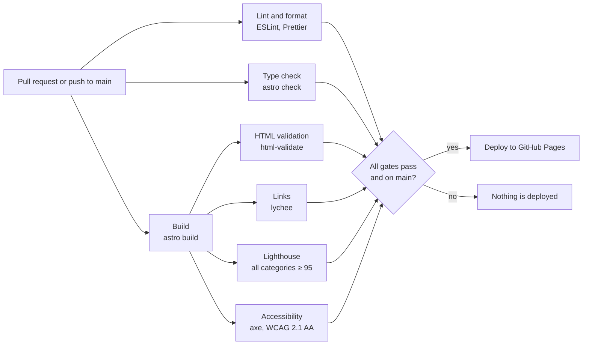

# ca15y.github.io

[](https://github.com/Ca15y/Ca15y.github.io/actions/workflows/ci.yml)
[](https://github.com/Ca15y/Ca15y.github.io/actions/workflows/link-check.yml)

My portfolio, at [ca15y.github.io](https://ca15y.github.io): case studies of cloud and DevOps work, experience, labs and skills.

The site is also a small DevOps project in its own right. Every change goes through a pull request, seven quality gates run in GitHub Actions, and the site deploys to GitHub Pages only when all of them pass.

## Pipeline



| Gate                | Tool                  | Fails when                                                                    |
| ------------------- | --------------------- | ----------------------------------------------------------------------------- |
| Lint and format     | ESLint, Prettier      | Code breaks a lint rule or isn't formatted                                    |
| Type check          | `astro check`         | TypeScript or content-schema errors                                           |
| Build               | `astro build`         | The site can't be built                                                       |
| HTML validation     | html-validate         | The built HTML is invalid                                                     |
| Links               | lychee                | An internal link, anchor or external URL is broken                            |
| Lighthouse          | Lighthouse CI         | Performance, accessibility, best practices or SEO scores below 95 on any page |
| Accessibility (axe) | Playwright + axe-core | Any WCAG 2.1 AA violation on any page, in the dark or the light theme         |

Workflows:

- [`ci.yml`](.github/workflows/ci.yml) runs the gates on every pull request and push to main, then deploys from main.
- [`link-check.yml`](.github/workflows/link-check.yml) checks every link each Monday and opens an issue if any are broken, because external pages can break without a commit here.
- [`dependabot.yml`](.github/dependabot.yml) opens weekly, grouped updates for npm packages and GitHub Actions.

## Run it locally

Requirements: Node.js 24 (see `.nvmrc`) and npm.

```bash
npm ci
npm run dev            # http://localhost:4321
```

Run the same gates as CI:

```bash
npm run lint
npm run format:check
npm run check          # astro check
npm run build
npm run validate:html
npm run test:a11y      # axe via Playwright; uses the installed Google Chrome locally
npm run lighthouse     # Lighthouse CI against dist/
```

Content lives in `src/content/projects/` (case studies) and `src/content/labs/`, with typed frontmatter defined in `src/content.config.ts`. Experience, skills, education and site details are in `src/data/site.ts`.

## Decisions

- **Astro, static output, no client framework.** The site is content, so it ships HTML and CSS. The only JavaScript is a few lines for the theme toggle.
- **Each gate is its own job.** A failure shows exactly which check broke, and independent gates run in parallel.
- **Actions pinned to commit SHAs.** A tag can be moved to point at different code; a SHA can't. Dependabot keeps the pins up to date.
- **Least-privilege permissions.** Workflows default to `contents: read`. Only the deploy job gets `pages: write` and `id-token: write`, and only the scheduled link check gets `issues: write`.
- **Deploys only after every gate.** The deploy job needs all seven gates and runs only on main.
- **One place for the site URL.** `site.config.mjs` holds the URL and base path, so moving to a custom domain is a one-line change.
- **Self-hosted fonts, no third-party scripts, no analytics.** Fewer requests and nothing tracking visitors.

## Repository settings (done by the owner)

These are set in GitHub, not in code.

**Turn on Pages and deploys**

1. Settings → Pages → Build and deployment → Source: **GitHub Actions**.
2. Settings → Secrets and variables → Actions → Variables → New repository variable: `PAGES_ENABLED` = `true`.

The deploy job is skipped until that variable exists, so merges to main stay green before Pages is switched on.

**Protect main**

Settings → Branches → Add branch ruleset (or classic branch protection) for `main`:

1. Require a pull request before merging.
2. Require status checks to pass, and add: `Lint and format`, `Type check`, `Build`, `HTML validation`, `Links`, `Lighthouse (all categories ≥ 95)`, `Accessibility (axe)`.
3. Require branches to be up to date before merging.
4. Block force pushes and deletions.

The checks only appear in the list after they have run once on a pull request.

## Later: custom domain

When there's a domain, DNS will be managed with Terraform with remote state. Either GitHub Pages serves the custom domain with HTTPS enforced, or the site moves to S3 and CloudFront provisioned by Terraform and deployed from GitHub Actions with OIDC instead of long-lived AWS keys.
